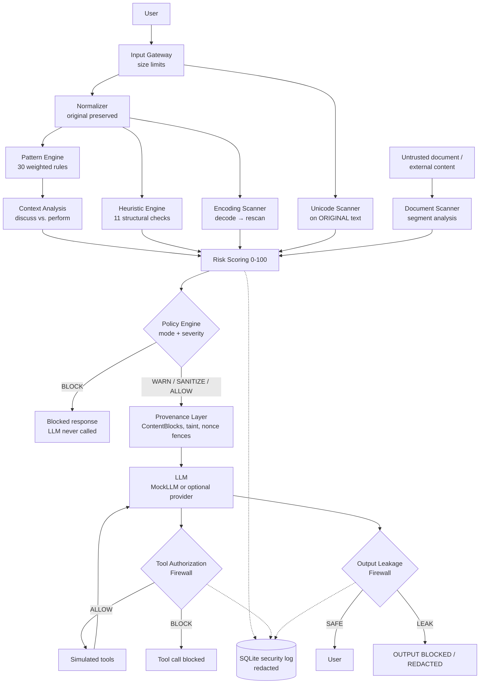
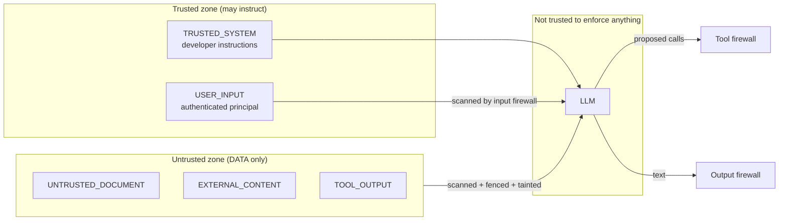

# PromptGuard Architecture

PromptGuard sits between users / external content and an LLM. It is built from
independent layers. Each one can fail without the others failing with it, so a
missed detection can still be contained.

The layers fall into two families:

| Family | Question it answers | Layers |
|---|---|---|
| **Detection** | "Does this input look malicious?" | Normalizer, Pattern Engine, Context Analysis, Heuristics, Encoding Scanner, Unicode Scanner, Risk Scoring, Policy Engine, Document Scanner |
| **Capability control** | "Even if a malicious instruction reaches the model, what is it allowed to do?" | Provenance Layer (taint + fences), Tool Authorization Firewall, Output Leakage Firewall |

## 1. Main architecture

## 2. Components and source files

| Component | File | Responsibility |
|---|---|---|
| Configuration | `app/config.py` | All thresholds, limits, policy tables, provider settings (env-driven, no secrets) |
| Schemas | `app/models/schemas.py` | Pydantic contracts between every layer |
| Normalizer | `app/detection/normalizer.py` | NFKC, invisible-char removal, homoglyph mapping, spaced-letter rejoin, whitespace |
| Unicode scanner | `app/detection/unicode_security.py` | Zero-width, bidi, TAG chars (decoded!), controls, homoglyph words, Zalgo |
| Pattern engine | `app/detection/patterns.py` | Rule table (`rule_id, name, category, description, pattern, severity, weight, enabled`) |
| Context analysis | `app/detection/context.py` | Discussion framing, quotation, imperative signals → dampening |
| Heuristics | `app/detection/heuristics.py` | Structural signals returning `{name, score, reason}` |
| Encoding scanner | `app/detection/encoding.py` | Base64, hex, URL, `\uXXXX`, HTML entities, ROT13; recursive with `MAX_DECODE_DEPTH` |
| Risk scoring | `app/firewall/scoring.py` | Explainable 0-100 score and breakdown |
| Policy engine | `app/firewall/policy.py` | LEARNING / MONITOR / ENFORCE → ALLOW / WARN / SANITIZE / BLOCK |
| Engine | `app/firewall/engine.py` | Orchestrates detection layers, fail-closed wrapper, stage trace |
| Explanations | `app/firewall/explain.py` | Human-readable "why" text |
| Document scanner | `app/firewall/documents.py` | Indirect injection, segment highlighting, SANITIZE |
| Pipeline | `app/firewall/pipeline.py` | Full request flow: input → provenance → LLM → tools → output |
| Provenance | `app/provenance/tracker.py` | `ContentBlock`, trust, taint propagation, nonce fences, forgery detection |
| Tools | `app/tools/registry.py` | Safe simulated tools (AST calculator, canned search, in-memory files, simulated outbox) |
| Tool firewall | `app/tools/authorization.py` | Six authorization checks before any tool runs |
| Output firewall | `app/output/leakage.py` | Canary / system-prompt / credential / exfil-URL detection; log redaction |
| LLM layer | `app/llm/base.py`, `mock.py`, `providers.py` | `BaseLLM` interface, deterministic MockLLM, optional OpenAI/Anthropic |
| Storage | `app/database/db.py`, `models.py` | SQLite event store (stdlib `sqlite3`) |
| API / UI | `app/routes/api.py`, `pages.py`, `templates/`, `static/` | FastAPI endpoints, Jinja2 pages, vanilla JS |

## 3. Data flow of one `/api/chat` request

1. **Provenance tracker** is created with a fresh random nonce. The system prompt becomes a
   `TRUSTED_SYSTEM` block, the prompt a `USER_INPUT` block, and an optional document an
   `UNTRUSTED_DOCUMENT` block.
2. **Input firewall** (`FirewallEngine.analyze`) runs on the user prompt. Each layer runs inside a
   fail-closed wrapper: an exception becomes the invariant `layer_error:<stage>` and the request is blocked.
3. **Document scanner** analyses the document as `UNTRUSTED_DOCUMENT`, per segment and as a whole.
4. **Fence check**: untrusted text containing the nonce or a fence tag is a forgery and is blocked.
5. **Decision** = the strictest of the input decision, the document decision and any fence violation.
   On BLOCK the LLM is never called.
6. On SANITIZE the document block is replaced by a *derived* block (still tainted, with lineage).
7. The **rendered prompt** wraps untrusted blocks in `<UNTRUSTED_DOCUMENT id=… nonce=…>` fences.
8. The **LLM** returns text and *proposed* tool calls. Each call records which block caused it.
9. The **tool firewall** authorizes each call. Only allowed calls execute, and their outputs become
   `TOOL_OUTPUT` blocks (tainted).
10. The **output firewall** scans the final text. On a leak, the response is replaced or redacted.
11. Before the result is returned or logged, it is passed through `redact_secrets`, so the canary
    can never leave the API, even inside tool arguments or the prompt preview.

## 4. Trust boundaries

* **User ↔ firewall:** user input is the principal, so it is allowed to *request* actions. It is
  still scanned, because users can be attackers.
* **External content ↔ firewall:** data only. Instructions found here are indirect injection.
* **LLM ↔ tools / user:** the model is treated as a *confused deputy*. Its proposals are checked,
  never trusted. This is why the tool and output firewalls run in every mode.

## 5. Design decisions

* **Detection ≠ enforcement.** Scoring produces a severity. The policy table (configurable) maps it to an action.
* **Fail closed.** A crashing detector blocks instead of silently allowing.
* **Explainability first.** Every point in the score has a line in `score_breakdown`, and dampened
  evidence is still shown.
* **Original input is never modified.** The normalized copy is used for detection only.
* **No secrets in logs.** The canary and credential-shaped strings are redacted before SQLite writes.
* **Offline by default.** MockLLM makes the whole system runnable and testable without an API key.
