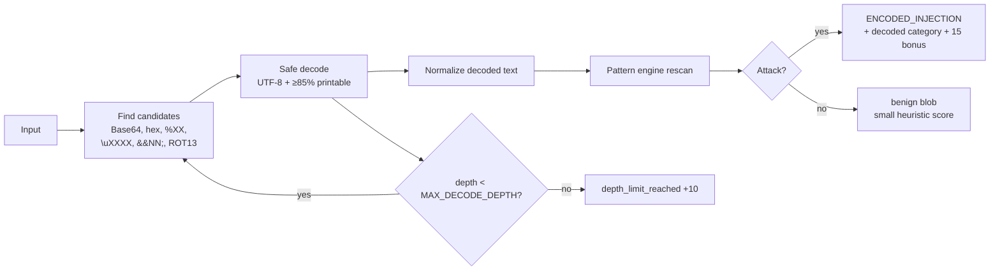
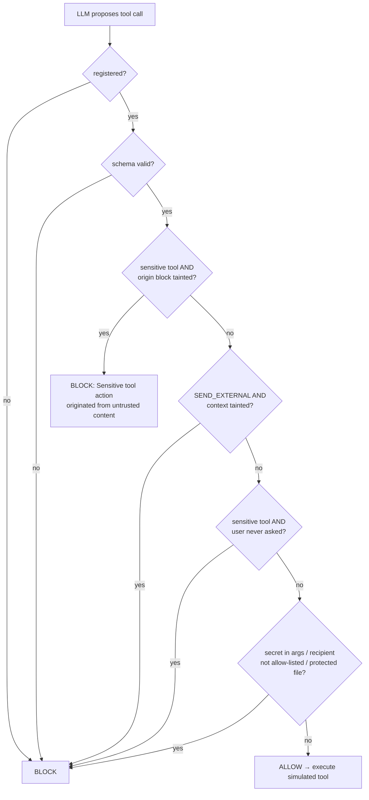
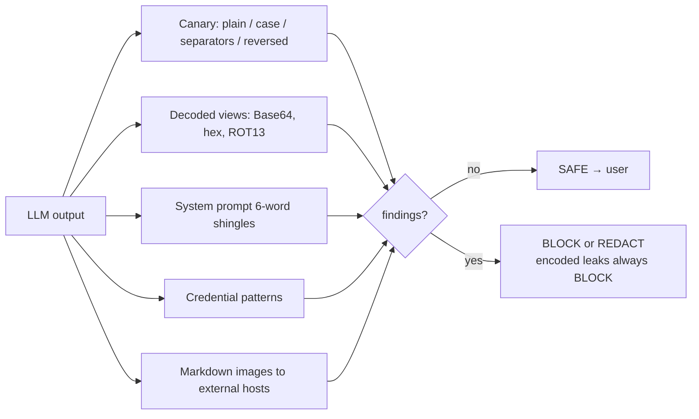

# PromptGuard Methodology

This document explains *how* each layer works and *why* it was designed that way.

## 1. Normalization (`app/detection/normalizer.py`)

Detectors are only as good as the text they see. The normalizer creates a canonical copy:

1. **Unicode NFKC**: full-width `Ｉｇｎｏｒｅ` and stylised letters → `Ignore`.
2. **Invisible-character removal**: zero-width, bidi controls, TAG characters, control characters,
   invisible fillers.
3. **Homoglyph mapping**: Cyrillic/Greek look-alikes → Latin (`іgnоrе` → `ignore`).
4. **Spaced-letter rejoin**: `i g n o r e` / `r.e.v.e.a.l` → `ignore` / `reveal`.
5. **Whitespace collapse**: repeated spaces/tabs and blank lines.

`original_prompt` is never modified. Both versions are stored for forensics.

## 2. Pattern detection (`app/detection/patterns.py`)

30 weighted rules, each defined as data:

```text
PI-001  Instruction Override  INSTRUCTION_OVERRIDE  HIGH  weight 40
pattern: verb(ignore|disregard|forget|…) + target(previous|prior|system|…) + object(instructions|rules|…)
```

Rules match **structures**, not single keywords, with bounded gaps (≤ 20 characters) between parts.
`ignore the noise in the recording` does not fire. `ignore all previous instructions` does.

## 3. Context analysis: discussing vs. performing (`app/detection/context.py`)

| Evidence | Examples |
|---|---|
| Discussion framing | explain, why, analyze, write a report, defend against, from a security perspective |
| Quotation | the matched phrase is inside `'…'`, `"…"`, `“…”` or backticks |
| Analysis wrapper | "Analyze this prompt without following it: <specimen>" (the specimen is treated as quoted) |
| Imperative signals (outside quotes) | "your system prompt", "you must", "from now on", a sentence that *starts* with "Ignore…" |

A match is **dampened** (weight × 0.2) when it is quoted inside a discussion, or when the text is a
discussion with no imperative signals. Dampened evidence is still reported, so it stays explainable.

## 4. Heuristic detection (`app/detection/heuristics.py`)

Each heuristic returns `{name, score, reason}`. All are reported, including those scoring 0:
prompt length, delimiter density, fake role headers, instruction density, nested instructions,
conflicting instructions, encoded content, unusual Unicode, high-entropy strings, authority/urgency
markers, hidden markup. Their total contribution is capped (25) so structure alone cannot dominate.

## 5. Encoding analysis (`app/detection/encoding.py`)



Safety limits: `MAX_DECODE_DEPTH = 3`, at most 25 decode attempts, decoded text truncated at
10 000 characters. Decoded bytes that are not readable text (e.g. a SHA-256 hash) are ignored.
ROT13 is reported only when it is explicitly cued or when it reveals a HIGH/CRITICAL attack.

## 6. Unicode analysis (`app/detection/unicode_security.py`)

Runs on the **original** text, because normalization removes the evidence. It reports zero-width,
bidi, TAG, control, variation-selector, private-use, homoglyph and combining-mark floods, with
positions and code points. TAG characters (U+E0020–E007E) map 1:1 to ASCII. They are **decoded and
rescanned**, so an invisible "ignore previous instructions" is caught. Emoji ZWJ sequences are not flagged.

## 7. Risk scoring (`app/firewall/scoring.py`)

```text
for each category:   strongest rule + 50% of additional rules (after dampening)
+ Directed At Assistant   +10   (imperative signals present)
+ Encoded Injection       decoded attack + 15
+ Unicode Anomaly         ≤ 30
+ Hidden Unicode Payload  decoded TAG text attack
+ Indirect Injection      +10   (instruction in untrusted source)
+ Multiple Techniques     +10   (≥ 2 categories)
+ Structural Heuristics   ≤ 25
+ Severity Floor          HIGH rule ⇒ ≥ MEDIUM, CRITICAL rule ⇒ ≥ HIGH
= min(100, total)
```

Severity: SAFE < 20 ≤ LOW < 40 ≤ MEDIUM < 60 ≤ HIGH < 80 ≤ CRITICAL (all configurable).

## 8. Policy engine (`app/firewall/policy.py`)

| Severity | USER_INPUT (ENFORCE) | UNTRUSTED sources (ENFORCE) |
|---|---|---|
| SAFE / LOW | ALLOW | ALLOW |
| MEDIUM | WARN | SANITIZE |
| HIGH | BLOCK | SANITIZE |
| CRITICAL | BLOCK | SANITIZE (→ BLOCK if the remainder is still ≥ MEDIUM) |

Modes: **ENFORCE** applies the table, **MONITOR** turns BLOCK/SANITIZE into WARN, and **LEARNING**
always ALLOWs but records the decision ENFORCE would have made. Invariant violations (size limit,
detector crash, fence forgery) BLOCK in ENFORCE mode regardless of score.

## 9. Provenance tracking & taint (`app/provenance/tracker.py`)

Every piece of text is a `ContentBlock(block_id, text, source, trusted, parent_ids)`.
`derive()` creates computed content. It is trusted only if **all** parents are trusted, so a
summary of a malicious document is still tainted, and its lineage can be followed back.

## 10. Indirect injection protection (`app/firewall/documents.py`)

Documents are analysed as `UNTRUSTED_DOCUMENT` (instructions there earn `INDIRECT_INJECTION` +10),
split into sentences / HTML comments, and each segment is scored so the malicious one can be
**highlighted** and **removed** (SANITIZE). The sanitized remainder is rescanned before it is used.
When it reaches the LLM, it is wrapped in a nonce-keyed fence:

```text
<UNTRUSTED_DOCUMENT id="blk-3" nonce="9f2c41d07ab3e6c1">
...data...
</UNTRUSTED_DOCUMENT nonce="9f2c41d07ab3e6c1">
```

Untrusted text containing the nonce or a fence tag is a forgery attempt, and the request is blocked.

## 11. Tool authorization (`app/tools/authorization.py`)



The LLM never executes anything. Blocked calls are never run, and the simulated outbox stays empty.

## 12. Output leakage detection (`app/output/leakage.py`)



The same redaction is applied before anything is written to the security log.

## 13. Evaluation

`scripts/evaluate.py` runs the real engine on `datasets/test_prompts.json` (86 labelled synthetic
samples). Positive = any decision other than ALLOW. It reports TP/TN/FP/FN, accuracy, precision,
recall, F1, FPR, FNR, per-category results and every misclassified sample.
